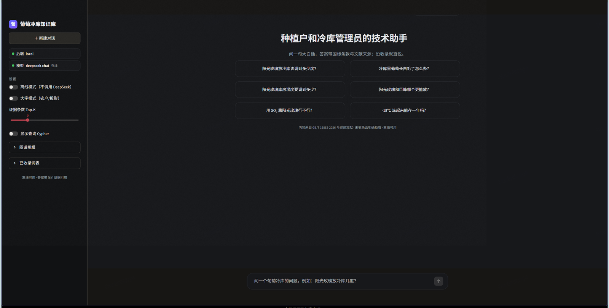
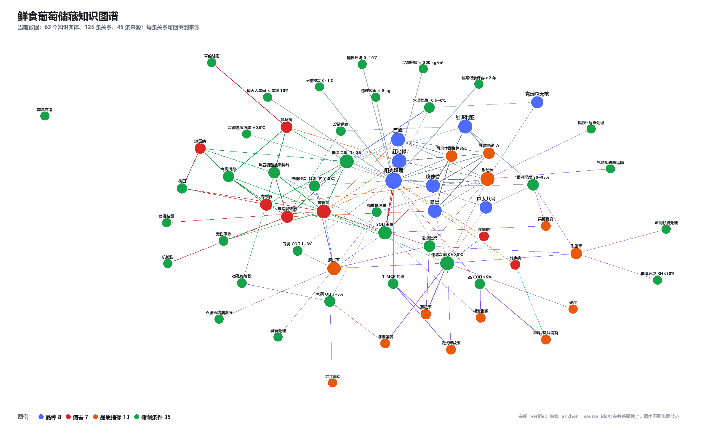
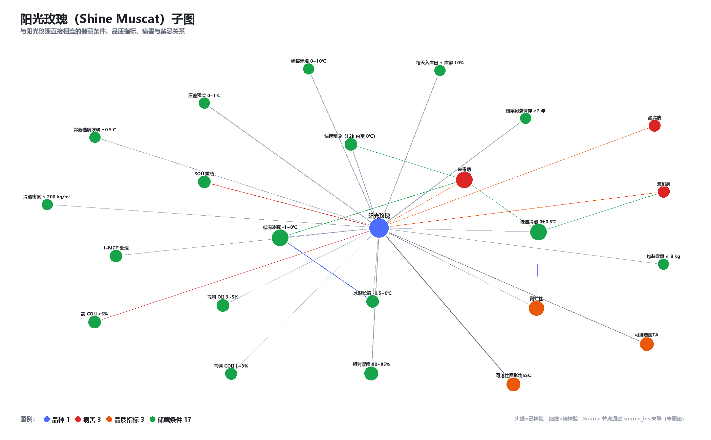

# 鲜食葡萄储藏知识图谱增强问答系统

面向鲜食葡萄采后贮藏与保鲜管理的知识图谱增强型智能问答系统：把国家标准与综述文献拆成可溯源的知识图谱，提问时先检索证据，再由大语言模型生成回答，并对引用和关键数值做机器校验。

- 公网演示：<https://yuzherumo-grape-storage-kg-qa.ms.show>
- 代码仓库：<https://github.com/Yuzherumo/grape-storage-kg-qa>
- 当前版本：v1.2（2026-11-22，新增农业农村部指南与 2018 温度试验数据）

## 1. 项目名称与一句话简介

**鲜食葡萄储藏知识图谱增强问答系统（grape-storage-kg-qa）**

用知识图谱承载 GB/T 16862-2026《鲜食葡萄冷藏技术》与相关综述中的储藏规范，让种植户、冷库管理员用大白话提问；系统先检索图谱证据，再让大语言模型在证据约束下生成「结论 + 依据 + 现在该做什么」，并校验引用编号与数值范围。图谱没有收录的问题直接说明没有证据，不编造答案。

## 2. 背景与实际应用场景

鲜食葡萄采后损耗高，问题通常不在「没有技术」，而在规范分散、术语专业、一线人员难以直接使用：温度湿度是个区间，预冷有时限，SO₂ 保鲜剂有品种耐受性和使用禁忌，病害处置又依赖诱因判断。直接问通用大模型，容易得到听起来合理但数字没有来源的回答。

| 使用者 | 典型场景 | 提问示例 | 系统输出 |
|---|---|---|---|
| 种植户 / 合作社 | 采后待入库，参数不确定 | 阳光玫瑰放冷库该调到多少度？ | 温度区间、预冷要求、分步动作、来源 |
| 冷库管理员 | 贮藏期发现霉变、发软、掉粒 | 冷库里葡萄长白毛了怎么办？ | 可能病害、立即处置、诱因规避 |
| 采购 / 质检 | 到货判断残值与货架期 | 阳光玫瑰和巨峰哪个更能放？ | 品种耐贮性基线、判定指标 |
| 农技员 / 学生 | 对比学习、写材料需要引用 | 用 SO₂ 熏阳光玫瑰行不行？ | 禁忌、争议来源、替代方案 |

## 3. 项目核心目标

1. **回答有据可查**：每条结论关联图谱证据，证据带来源、定位、原文摘录与核验状态。
2. **答案可执行**：固定输出「结论 / 依据 / 现在该做什么」，动作面向当天可执行。
3. **不知道就说不知道**：证据覆盖不足或问题超出图谱范围时明确拒答，不用其他品种或通用知识填补。
4. **可离线运行**：没有 API Key、断网时退化为模板答案，功能与引用保持完整。

## 4. 系统真实功能

| 功能 | 说明 | 主要实现 |
|---|---|---|
| 中文口语实体链接 | 品种、病害、储藏条件、品质指标的别名与症状词匹配，处理全角、下标、拉丁词边界 | `app/linking.py` |
| 意图路由 | 10 类意图（温度、湿度、气调、耐贮性、病害处置、病害风险、品质判断、品种对比、禁忌、通用），规则加权 + 句式和实体先验 | `app/planner.py`、`app/planner_rules.py` |
| 参数化图谱检索 | 本地后端纯标准库执行；可选 Neo4j 后端执行对应 Cypher 模板 | `app/store/`、`graph/queries/` |
| 证据组织与编号 | 三元组 + 值/单位 + 来源 + 定位 + 原文摘录 + 核验状态 + 置信度，按命中实体与分数排序 | `app/qa.py`、`app/store/base.py` |
| 证据约束生成 | 在线调用 OpenAI 兼容接口（默认 DeepSeek）；无 Key 或异常时使用模板 | `app/qa.py`、`app/llm.py` |
| 引用与数值校验 | `[E#]` 引用存在性、引用与事实句匹配、数字来源、单位/区间、越界判断 | `app/qa.py` |
| 覆盖守卫与拒答 | 证据必须触达命中的品种/病害主实体，否则返回 `no_evidence` | `app/qa.py` |
| 多轮追问 | 明确指代式追问时继承上一轮实体，问题出现新实体则不继承 | `app/qa.py` |
| 知识图谱可视化 | 侧栏开关「知识图谱视图」，可切换全图 / 阳光玫瑰子图；点击节点查看描述、属性与关联事实，支持缩放、拖拽、筛选、搜索 | `app/graph_view.py`、`app/graph_interactive.py` |
| 双后端 | `local`（默认，无数据库）与 `neo4j`（需驱动与服务），失败自动回落并告警 | `app/store/__init__.py` |
| 评测与校验脚本 | 数据十项校验、Cypher 静态校验、Kùzu 实跑、黄金集评测 | `scripts/`、`tests/` |

## 5. 系统演示

在线体验：<https://yuzherumo-grape-storage-kg-qa.ms.show>（魔搭创空间，免费 CPU 实例，空闲后首次访问需冷启动几十秒）。







界面为对话式布局：左侧为新建对话、后端/模型状态、离线模式、大字模式、Top-K、Cypher 开关与最近提问；中间为对话流；回答下方可展开「依据 · N 条证据」。图谱视图中点击节点可查看科普描述、属性与关联事实。

## 6. 系统整体架构

```
用户提问
  → app/linking.py        归一化 + 实体链接
  → app/planner.py        意图路由 + 构造 QuerySpec
  → app/store/            参数化检索（local / neo4j）
  → app/qa.py             证据排序、编号、覆盖校验、模板/LLM 生成、引用与数值校验
  → app/ui.py             渲染 AnswerResult（对话、证据卡、图谱视图）
```

详细的数据结构、函数与异常路径见 [docs/architecture.md](docs/architecture.md)；接口契约见 [docs/api.md](docs/api.md)。

## 7. 核心技术与实现思路

1. **检索优先，生成受限**：实体链接与意图路由是规则实现，可确定性测试；大模型只负责把证据写成自然语言，系统提示词要求逐结论标注 `[E#]`。
2. **证据是一等对象**：`Evidence` 同时携带三元组、数值、来源、定位、摘录与核验状态；排序依据命中实体数、置信度与证据状态。
3. **覆盖守卫**：typed 意图的证据必须触达命中的品种/病害主实体，防止「问 A 品种却拿 B 品种数据」。
4. **双层校验**：引用校验检查 `[E#]` 是否存在、是否与事实句相关；数值校验检查单位、区间与越界，对无来源数字记 `unsourced_number`。
5. **可控降级**：无 Key、超时、401/429/5xx、后端不可用等都有明确告警与模板兜底，不把异常包装成正常答案。
6. **数据单一真相**：CSV 是唯一数据源，Cypher 由脚本生成并可做漂移检查；本地后端与 Neo4j 后端共用同一份数据语义。

## 8. 知识图谱数据说明

图谱规模按两个口径统计，避免混淆：

- **知识实体 58 个**：品种 8、储藏条件 30、品质指标 13、病害 7；
- **来源节点 19 个**：国标 1、综述 9、论文 6、行业资料 3；
- **图谱节点 77 个** = 58 知识实体 + 19 来源节点（来源节点只用于溯源，不进入实体链接词表）；
- **关系 115 条**：9 种谓词，`verified` 69 条、`anchor` 46 条；
- 另有 28 个节点的科普描述（8 品种 / 7 病害 / 13 指标）、20 条阳光玫瑰核心子集快照。

谓词分布：`REQUIRES` 27、`PREVENTED_BY` 22、`AFFECTS` 24、`HAS_INDICATOR_VALUE` 18、`SUSCEPTIBLE_TO` 8、`INDUCED_BY` 7、`CONTRA_INDICATED_FOR` 4、`ALTERNATIVE_TO` 3、`INDICATES` 2。

数据来源、字段含义、核验规则与统计依据见 [docs/data.md](docs/data.md)；来源清单与条文摘录见 [docs/sources.md](docs/sources.md)。

## 9. 安装与运行

**环境要求**：Python 3.10+（本项目在 Python 3.12 实测），Windows PowerShell（仓库脚本为 PowerShell）。

```powershell
# 1) 安装环境：创建 .venv、安装依赖、运行数据/Cypher 校验
.\install.ps1

# 2) 启动应用
.\run.ps1
#    → http://127.0.0.1:8501

# 3) 只做自检，不启动服务
.\run.ps1 -Check
```

Linux/macOS 手动方式：

```bash
python3 -m venv .venv && . .venv/bin/activate
pip install -r requirements.txt
python scripts/validate_data.py
python scripts/validate_cypher.py
streamlit run app.py --server.port 8501
```

在线模式：复制 `.env.example` 为 `.env`，填写 `DEEPSEEK_API_KEY`（可选配置模型与超时）。不配置时自动走离线模板模式，功能完整、答案仍带 `[E#]` 引用。`.env` 已被 `.gitignore` 排除，不进入仓库。

## 10. 项目目录结构

```
.
├─ app.py                    # 云端入口（streamlit run app.py）
├─ app/                      # 应用代码
│  ├─ config.py              # 环境变量与 Settings
│  ├─ contracts.py           # EntityHit / Evidence / QuerySpec / AnswerResult
│  ├─ linking.py             # 归一化与实体链接
│  ├─ planner.py             # 意图路由与查询构造
│  ├─ planner_rules.py       # 触发词、句式与操作条件
│  ├─ qa.py                  # 问答主流程、模板、校验
│  ├─ llm.py                 # LLM 客户端、错误分类与退避
│  ├─ store/                 # local / neo4j 后端
│  ├─ graph_view.py          # 图谱布局与 SVG
│  ├─ graph_interactive.py   # 可交互图谱 HTML
│  └─ ui.py                  # Streamlit 界面
├─ data/                     # CSV 唯一数据源 + schema 与评测集
├─ graph/                    # schema.cypher、生成物、10 个查询模板
├─ scripts/                  # 校验、生成、评测、部署、打包脚本
├─ tests/                    # pytest 测试
├─ docs/                     # 文档（架构、数据、验证、接口、来源等）
├─ install.ps1 / run.ps1     # 环境安装与一键启动
├─ requirements.txt / pyproject.toml / pytest.ini
└─ LICENSE
```

## 11. 测试与验证

当前环境（2026-11-22，Windows 11，Python 3.12.14）：

| 项 | 结果 |
|---|---|
| pytest | **325 passed / 2 skipped**（2 skipped：未安装 Neo4j 驱动的双后端一致性测试、默认跳过的 LLM 标记测试） |
| 数据校验 | 十项校验通过，错误 0，告警 2（46 条 anchor 的 quote 为空、S2a 快照 11 条 quote 为空，均符合 anchor 规则） |
| Cypher | 13 个 `.cypher` 文件静态校验通过；CSV→Cypher 生成物无漂移 |
| 图谱查询实跑 | Kùzu 0.11.3 内存库：77 节点 / 115 关系与 CSV 一致，6 道题结果与本地后端一致，4 条 verified 条文定点命中 |
| 黄金集评测 | 核心题 5/5、越界探针 1/1、口语变体意图 12/12、实体命中 12/12 |
| CI | GitHub Actions 两个 job（Ubuntu test、Windows 脚本语法）通过（run 44987585590） |

详细命令、历史记录、未验证项与 CI 状态见 [docs/validation.md](docs/validation.md)；评测报告由 `scripts/eval_qa.py` 生成到 [docs/eval_results.md](docs/eval_results.md)。

## 12. 已知限制

- 图谱是演示级规模：8 个品种、7 种病害、30 个条件、13 个指标，共 115 条关系，不是全领域知识库；
- 46 条关系仍为 `anchor`（原文未获取，标注待核验），其中多数依赖尚未获得的综述或论文；
- Neo4j 服务端未在当前网络实际运行（官方下载域名 403），以 Kùzu 等价查询、静态校验与便携安装脚本替代；双后端一致性测试因缺少驱动处于 skipped；
- 引用与数值校验是规则启发式，不是自然语言事实蕴含，不能保证语义级正确；
- 在线模式依赖外部 LLM 服务，回答有随机性；离线模板更稳定但表达较固定；
- 免费公网实例会休眠，首次访问需要冷启动。

完整清单见 [docs/limitations.md](docs/limitations.md)。

## 13. 后续改进方向

1. 补齐未获取原文的文献，将 46 条 `anchor` 逐步升级为 `verified`；
2. 扩充品种、病害、贮藏条件与产地差异，建立数据更新与复核流程；
3. 在真实 Neo4j 实例上完成导入、约束与双后端一致性验证；
4. 引入人工评分集，评估答案可读性、可执行性与引用准确性，而不只做规则匹配；
5. 接入冷库温湿度记录，做基于实时条件的个性化建议（当前不做）。

## 14. 项目地址、许可证与引用

- 代码仓库：<https://github.com/Yuzherumo/grape-storage-kg-qa>
- 在线演示：<https://yuzherumo-grape-storage-kg-qa.ms.show>
- 许可证：见 [LICENSE](LICENSE)。代码与数据版权归参赛团队所有，仅供赛事评审与学习交流，未经许可不得商用或再分发；引用的标准与论文仅保留题录与条级摘录，原文不随仓库分发。
- AI 使用说明：见 [docs/ai_usage.md](docs/ai_usage.md)。
- 引用格式（如需引用本作品）：

```
鲜食葡萄储藏知识图谱增强问答系统（grape-storage-kg-qa），农客松 2026 参赛作品，
https://github.com/Yuzherumo/grape-storage-kg-qa ，2026。
```
