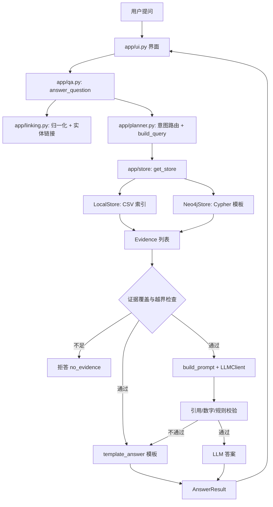

# 系统架构

本文描述当前代码的实际调用关系与数据流。接口细节见 [api.md](api.md)，数据口径见 [data.md](data.md)，验证结果见 [validation.md](validation.md)。

## 1. 设计原则

1. **检索优先**：先确定问题涉及哪些实体、属于哪类意图，再检索图谱证据；不把问题直接交给大模型自由发挥。
2. **确定性优先**：实体链接与意图路由用规则实现，可单测、可复现；大模型只负责把证据写成自然语言。
3. **证据约束**：回答中的每条结论应能对应到本轮证据编号；证据不足或未覆盖时明确拒绝。
4. **可降级**：大模型、Neo4j、数据文件任一不可用时不崩溃，给出明确状态与降级答案。

## 2. 总体结构

## 3. 模块与代码对应

| 层次 | 文件 | 关键函数 / 类 | 职责 |
|---|---|---|---|
| 入口 | `app.py`、`app/ui.py` | `main()` | 云端入口包一层 `app.ui.main`；界面通过 `load_runtime()` 初始化配置、后端与问答函数 |
| 配置 | `app/config.py` | `Settings`、`load_settings()` | 读取 `.env` / 环境变量，校验端口、Top-K、超时、后端等配置 |
| 数据契约 | `app/contracts.py` | `EntityHit`、`Evidence`、`QuerySpec`、`AnswerResult`、`WARN_*` | 模块间共享结构与告警常量 |
| 实体链接 | `app/linking.py` | `normalize_text()`、`load_catalog()`、`link_entities()` | 全角/语气词归一化，词典最长匹配，拉丁词边界，返回带原文位置的命中实体 |
| 意图路由 | `app/planner.py` | `normalize_question()`、`route()`、`build_query()` | 触发词加权、实体先验、句式覆盖，生成意图与 `QuerySpec` |
| 路由规则 | `app/planner_rules.py` | `TRIGGERS`、`PATTERNS`、`HOWTO_KEYWORDS`、`OPERATION_CONDITIONS` | 规则数据与关键词 |
| 后端选择 | `app/store/__init__.py` | `get_store()` | 按 `GRAPH_BACKEND` 选择 `LocalStore` / `Neo4jStore`，捕获连接失败并回落 |
| 本地后端 | `app/store/local_store.py` | `LocalStore._load()`、`_build_index()`、`execute()`、各意图 `_handle_*` | 读取 CSV、建立实体/三元组索引，按意图执行检索 |
| Neo4j 后端 | `app/store/neo4j_store.py` | `Neo4jStore.execute()`、`query_cypher()` | 读取 `graph/queries/*.cypher`，参数化查询；失败由上层回落 |
| 证据排序 | `app/store/base.py` | `score_evidence()`、`rank_evidence()`、`build_evidence()`、`GraphStore` | 统一打分、排序、去重与 `Evidence` 构造 |
| 问答编排 | `app/qa.py` | `answer_question()`、`template_answer()`、`compose_steps()`、`build_prompt()`、`verify_citations()`、`check_numbers()`、`detect_out_of_range()`、`validate_llm_answer()` | 主流程、模板生成、LLM 调用与校验 |
| 大模型 | `app/llm.py` | `LLMClient`、`classify_error()`、`is_retryable()`、`backoff_seconds()`、`StubLLM` | OpenAI 兼容调用，401/429/5xx/超时/网络错误分类与退避 |
| 图谱可视化 | `app/graph_view.py`、`app/graph_interactive.py` | `load_graph()`、`layout()`、`to_svg()`、`interactive_html()` | 从 CSV 构图、力导向布局、生成静态与可交互视图 |
| 界面 | `app/ui.py` | `load_runtime()`、`_ask()`、`render_assistant()`、`build_graph_html()` | 会话状态、多轮上下文、证据卡、图谱组件 |

## 4. 一次提问的完整路径

以「阳光玫瑰放冷库该调到多少度？」为例：

1. **界面接收**：`app/ui.py` 的 `st.chat_input` 触发 `_ask()`；`_ask()` 把 `store`、`k`、`allow_llm`（离线模式开关）、`settings`、`context`（上一轮实体）传给 `answer_question()`。
2. **实体链接**（`app/qa.py` → `app/linking.py`）：`normalize_text()` 做全角、大小写、语气词与下标归一化；`link_entities()` 在实体词典上做最长匹配并处理拉丁词边界，返回 `EntityHit`（`node_id`、`label`、`surface`、位置）。
3. **多轮继承**：若本轮没有命中实体，且问句是明确的指代式追问（「那湿度呢」），才继承上一轮实体，并写入 `AnswerResult.context_note`；出现新实体时不继承。
4. **意图路由**（`app/planner.py`）：`route()` 综合触发词分数、实体先验与句式覆盖，得到意图与置信度；低置信度会加入 `low_confidence_intent` 告警。
5. **构造查询**：`build_query(intent, hits, k)` 生成 `QuerySpec`（意图、参数、Cypher 模板文件名）。
6. **图谱检索**（`app/store/`）：`get_store()` 返回后端；`LocalStore.execute()` 在内存索引中按意图取边，`Neo4jStore.execute()` 执行对应模板。检索结果统一为 `Evidence` 列表。
7. **证据排序**：`app/store/base.py` 的 `score_evidence()` 计算
   `0.5 × confidence + 0.3 × status_weight + 0.2 × 实体命中比例`（`verified` 权重 1.0，`anchor` 0.6）；`qa` 再按「与命中实体相连的个数」优先排序，去重并截断到 `k`（`general` / `variety_compare` 至少 12 条）。
8. **覆盖守卫**：typed 意图下，证据必须触达命中的品种/病害主实体；否则清空证据并返回 `no_evidence` 的拒答。
9. **越界检测**：`detect_out_of_range()` 检查问题中的温度是否超出证据覆盖区间（如 -18℃），为真时模板直接给「不可行」并标记 `out_of_range`。
10. **生成**：
    - 先由 `template_answer()` 基于证据拼装「结论 / 依据 / 现在该做什么」；
    - 在线模式且 `allow_llm` 时，`build_prompt()` 把证据编号与来源写入提示词，`LLMClient.complete()` 生成回答；
    - 结果按 `answer + evidence` 的哈希做进程内缓存（最多 64 条）。
11. **校验回路**（仅 LLM 答案）：
    - `verify_citations()`：`[E#]` 必须存在；缺失则要求模型重写一次，仍缺失则回退模板；
    - `validate_llm_answer()`：检查 `unsupported_fact`（事实句缺引用）、`citation_mismatch`（引用与句子字面不相关）、`anchor_high_risk`（仅凭 anchor 给高风险参数）、关键数值错误；
    - 引用不匹配允许纠正一次，失败或出现关键错误则 `llm_answer_rejected` 并回退模板；
    - `check_numbers()`：答案中的数字必须能在证据中找到对应值/区间，否则 `unsourced_number`；超出证据范围记 `out_of_range`。
12. **收尾**：`compose_steps()` 生成最多 3 步可执行动作；最终答案确定后重新计算引用编号（避免步骤引用新证据后 `cited_ids` 遗漏），组装 `AnswerResult` 返回界面。
13. **渲染**：`app/ui.py` 显示回答正文、`[E#]` 角标、可折叠证据卡（来源、条款/页码、已核验/待核验、置信度）、告警标签与元信息。

## 5. 证据对象与来源追踪

`Evidence`（`app/contracts.py`）字段：

| 字段 | 含义 |
|---|---|
| `eid` | 本轮证据编号，如 `E1` |
| `subject` / `predicate` / `object` | 三元组 |
| `value` / `unit` / `value_min` / `value_max` | 数值、单位与区间 |
| `properties` | 主体/客体 id 等结构化信息 |
| `source_ids` / `source_titles` | 来源 id 与标题 |
| `locator` / `quote` | 条款号/页码、原文摘录 |
| `status` / `confidence` / `score` | 核验状态、来源置信度、排序分 |

来源链路：`triples.csv.source_ids` → `sources.csv.id` → 展示标题与可获取性；`locator`/`quote` 提供条级定位。校验器要求 `verified` 必须有原文摘录，`anchor` 必须写明待核验点。

## 6. 在线模式与离线模式

| 维度 | 离线模板模式 | 在线模式 |
|---|---|---|
| 触发条件 | 未配置 `DEEPSEEK_API_KEY`、界面打开「离线模式」、或 LLM 调用失败 | 配置 Key 且 `allow_llm=True` |
| 生成 | `template_answer()` 基于证据拼装 | `LLMClient.complete()` 生成，提示词要求逐结论标注 `[E#]` |
| 校验 | 引用校验 + 数值校验 | 引用校验 + 数值校验 + `validate_llm_answer()` 规则检查 |
| 稳定性 | 确定性、可离线复现 | 受网络、限流、模型随机性影响 |
| 表达 | 句式较固定 | 更自然，但可能被校验拒绝并回退模板 |

LLM 错误分类（`app/llm.py`）：`auth`（401/403，不重试）、`rate_limit`（429）、`server`（5xx）、`timeout`、`network`、`bad_request`、`unknown`；`rate_limit`/`server`/`timeout`/`network` 按指数退避重试，其余只请求一次。最终失败统一转成 `llm_unavailable` 或 `llm_timeout` 告警并回退模板。

## 7. 异常与降级路径

| 情况 | 行为 | 告警/返回 |
|---|---|---|
| 空问题 | 提示输入问题，不查图 | `no_evidence` |
| general 意图但无实体 | 不查图，提示带品种/病害再问 | `no_evidence` |
| 非 temperature 意图但无实体 | 不查全库凑答案 | `no_evidence` |
| 数据文件缺失 / 后端异常 | 返回「图谱当前不可用」，不编造 | `no_evidence` |
| Neo4j 连接失败 | 回落到 `LocalStore` | `backend_fallback` |
| 图谱无证据 | 说明未收录，建议换问法 | `no_evidence` |
| 证据与命中主实体无关 | 覆盖守卫拦截，清空证据 | `no_evidence` |
| LLM 未配置/401/超时/网络 | 模板答案 | `llm_unavailable` / `llm_timeout` |
| 引用缺失且纠正失败 | 模板答案 | `no_citation` |
| 引用与句子不匹配 | 纠正一次，失败回退模板 | `citation_mismatch` / `llm_answer_rejected` |
| 仅凭 anchor 给高风险参数 | 回退模板 | `anchor_high_risk` |
| 答案含证据外数字 | 模板答案 | `unsourced_number` |
| 问题温度超出证据区间 | 明确「不可行」 | `out_of_range` |
| 核心模块未就绪 | 明确不可用，不回固定答案 | `system_unavailable` |

## 8. 扩展点

- **新增意图**：在 `app/planner_rules.py` 增加触发词/句式，在 `app/planner.py` 的 `build_query()` 与 `app/store/local_store.py` 增加对应检索分支，并在 `graph/queries/` 增加模板（如使用 Neo4j）。
- **新增数据**：只改 `data/*.csv` 与 `data/schema.json`，然后运行 `scripts/validate_data.py`、`scripts/gen_cypher.py`；不要手改 Cypher 生成物。
- **替换生成模型**：实现与 `LLMClient.complete()` 相同签名即可接入其他 OpenAI 兼容服务；`app/qa.py` 的校验逻辑不依赖具体模型。
- **替换后端**：实现 `app/store/base.py` 的 `GraphStore` 接口（`execute`、`stats`、`health`、`query_cypher`），在 `get_store()` 中接入。

## 9. 与文档的对应关系

| 文档 | 内容 |
|---|---|
| [api.md](api.md) | 数据结构、模块函数签名、稳定性承诺 |
| [data.md](data.md) | 数据文件、统计口径、核验规则 |
| [validation.md](validation.md) | 测试命令、结果、未验证项 |
| [limitations.md](limitations.md) | 能力边界与已知限制 |
| [sources.md](sources.md) | 来源清单与条文摘录 |
| [neo4j_verify.md](neo4j_verify.md) | Neo4j 未实跑的原因与替代验证 |
